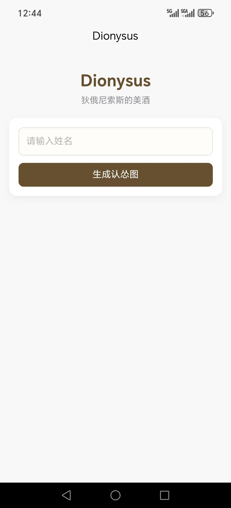
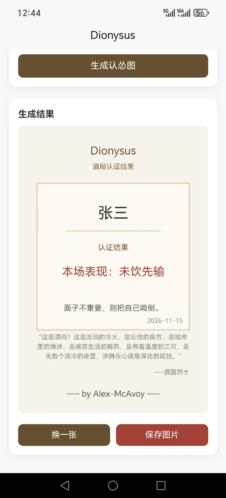
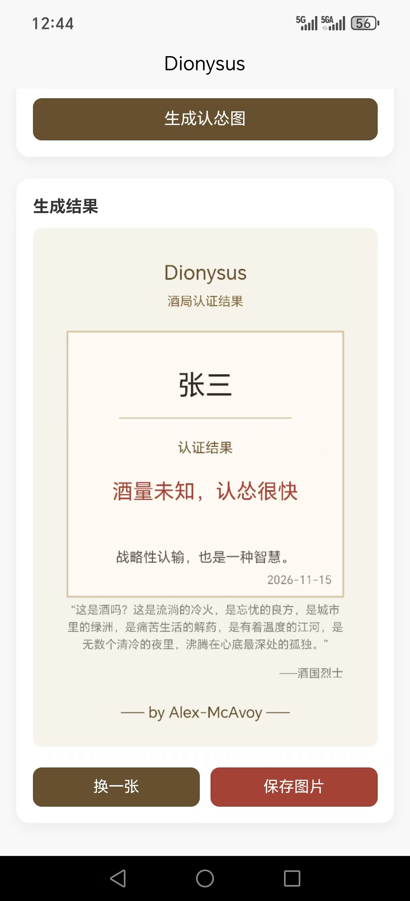
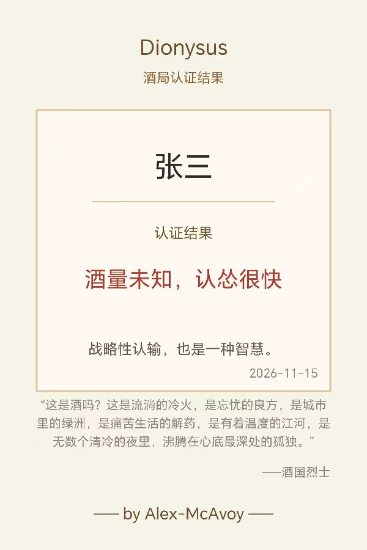

# Dionysus
<!-- PROJECT SHIELDS -->

[![Contributors][contributors-shield]][contributors-url]
[![Forks][forks-shield]][forks-url]
[![Stargazers][stars-shield]][stars-url]
[![Issues][issues-shield]][issues-url]
[![Downloads][Download-shield]][download-url]

<!-- PROJECT LOGO -->
<br />

<p align="center">
  <h2 align="center"><strike>Dionysus</strike> 酒局认怂生成器</h2>
</p>
<p align="center">
  
  <p align="center">
    <a href="https://github.com/Alex-McAvoy/Dionysus"><strong>探索本项目的文档 »</strong></a>
    <br />
    <br />
    <a href="https://github.com/Alex-McAvoy/Dionysus/issues">报告Bug</a>
    ·
    <a href="https://github.com/Alex-McAvoy/Dionysus/issues">提出新特性</a>
    ·
    <a href="https://github.com/Alex-McAvoy/Dionysus/releases">发行说明</a>
  </p>
</p>

## 目录

1. [说明](#说明)
2. [功能介绍](#功能介绍)
3. [效果展示](#效果展示)
4. [开发指南](#开发指南)
   1. [项目运行](#项目运行)
   2. [文件目录说明](#文件目录说明)
   3. [技术实现](#技术实现)
   4. [部署](#部署)
   5. [使用框架](#使用框架)
5. [待处理](#待处理)
   1. [已完成](#已完成)
   2. [进行中](#进行中)
   3. [计划中](#计划中)
   4. [Bug](#bug)
6. [参与项目](#参与项目)
   1. [如何参与](#如何参与)
   2. [贡献者](#贡献者)
7. [鸣谢](#鸣谢)

## 说明

本项目旨在以狄俄尼索斯之名，为酒局中的认怂选手颁发一份独一无二的荣誉证书。

用户只需输入姓名，即可生成酒局认证结果，并支持图片预览和保存。

无需后端服务器，图片通过客户端 Canvas 在本地生成，无需上传用户姓名或图片至服务器。

**特别声明：** 本项目仅供娱乐，不倡导过量饮酒或强迫饮酒。适度饮酒，理性认怂。

## 效果展示

<p align="center">
  
  
  
  
</p>

## 开发指南

### 项目运行

本项目基于 uni-app + Vue 3 开发，推荐使用 HBuilderX 进行开发与调试。

1. 克隆项目

   ```
   git clone https://github.com/Alex-McAvoy/Dionysus.git
   ```

2. 使用 HBuilderX 打开项目根目录 `Dionysus`

3. 在 HBuilderX 中选择：`运行 → 运行到浏览器`

4. 等待项目编译完成，即可在浏览器中使用

### 文件目录说明

```
Dionysus/
├── pages/
│   └── index/
│       └── index.vue
├── static/
│   └── logo.png
├── App.vue
├── index.html
├── main.js
├── manifest.json
├── pages.json
├── uni.promisify.adaptor.js
├── uni.scss
└── README.md
```

### 部署

暂无

### 使用框架

- [uni-app](https://uniapp.dcloud.net.cn/)

## 参与项目

欢迎对本项目感兴趣的开发者参与开发、提交建议和反馈问题。

### 如何参与

大致流程如下：

1. 将主仓库 Fork 到自己的仓库中
2. 将 Fork 后的分支仓库 Clone 到本地
3. 在本地进行修改后 Commit 更改
4. 将这些更改 Push 到克隆的分支仓库
5. 提交 Pull Request 至主仓库

对于 Commit 摘要，按照如下格式书写：

```
[修改类型] 修改内容
```

修改类型分为以下几类：

- `Add`：添加新模块或新功能
- `Fix`：修正现有模块的错误
- `Update`：更新现有模块或功能
- `Refactor`：对现有页面或模块进行重构
- `Revert`：回退之前的更改
- `Docs`：更新项目文档
- `Style`：调整页面样式

### 贡献者

暂无。


## 鸣谢

- [uni-app](https://uniapp.dcloud.net.cn/)
- [HBuilderX](https://www.dcloud.io/hbuilderx.html)

<!-- links -->
[contributors-shield]: https://img.shields.io/github/contributors/Alex-McAvoy/Dionysus.svg?style=flat-square
[contributors-url]: https://github.com/Alex-McAvoy/Dionysus/graphs/contributors
[forks-shield]: https://img.shields.io/github/forks/Alex-McAvoy/Dionysus.svg?style=flat-square
[forks-url]: https://github.com/Alex-McAvoy/Dionysus/network/members
[stars-shield]: https://img.shields.io/github/stars/Alex-McAvoy/Dionysus.svg?style=flat-square
[stars-url]: https://github.com/Alex-McAvoy/Dionysus/stargazers
[issues-shield]: https://img.shields.io/github/issues/Alex-McAvoy/Dionysus.svg?style=flat-square
[issues-url]: https://img.shields.io/github/issues/Alex-McAvoy/Dionysus.svg
[download-shield]: https://img.shields.io/github/downloads/Alex-McAvoy/Dionysus/total.svg
[download-url]: https://tooomm.github.io/github-release-stats/?username=Alex-McAvoy&repository=Dionysus
